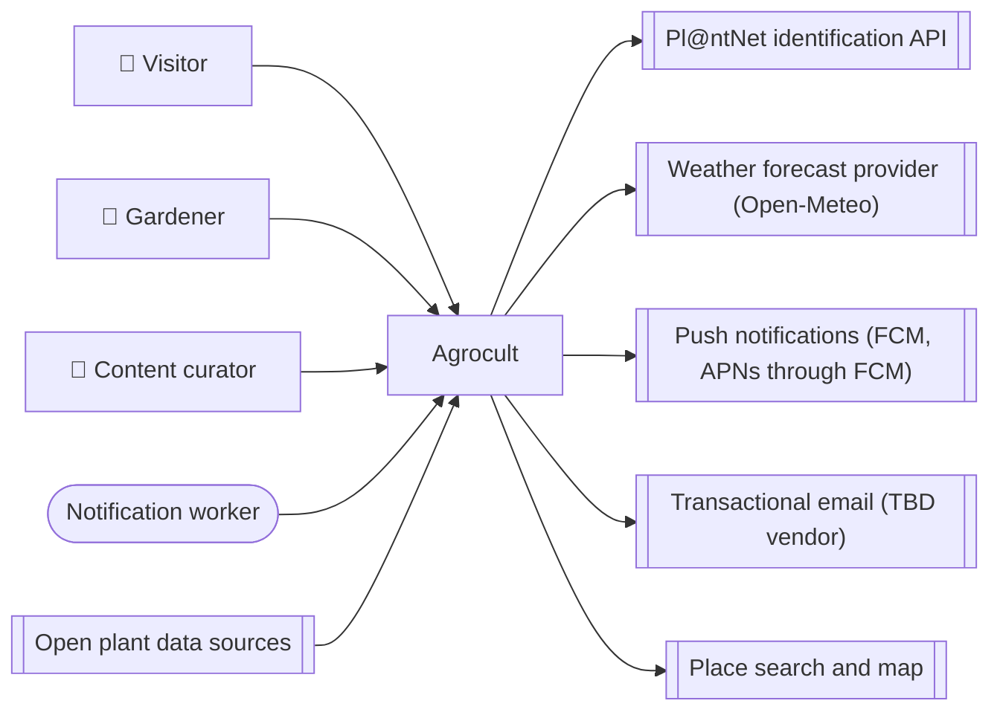

<!-- GENERATED from design/ — do not edit. Rebuild with tools/design/build.py -->
# Agrocult — overview

_Generated document · design v1.0.0 · source e80104843be7_

Mobile app (Android/iOS) that tells amateur gardeners in Greece what to do today for their own plants, based on the local weather at each of their gardens. It combines a plant catalogue with practical growing instructions for the Mediterranean climate and a personal garden with smart, weather-driven notifications.

**Status:** baselined at v1.0.0 (2026-10-13)

## Documents

- [Scope](scope.md)
- [Actors and use cases](use-cases.md)
- [External systems](external-systems.md)
- [Data](data.md)
- [Security](security.md)
- [Architecture](architecture.md)
- [Integrations](integrations.md)
- [Operations](operations.md)
- [Phases](phases.md)
- [All decisions](decisions.md)

## Context

## Open decisions

_none_

## Deferred

- DATA-007 — Personal season insights → after MVP
- DATA-008 — Anonymous regional insights from all users → after MVP
- DEC-005 — Android first, iOS later → after Android MVP release
- OPS-002 — Production hosting → before first production deploy
- SCOPE-007 — Post-MVP ideas the data model must support → after MVP
- SCOPE-009 — Sign-in with external providers → after MVP
- EXT-004 — Transactional email → before first production deploy
