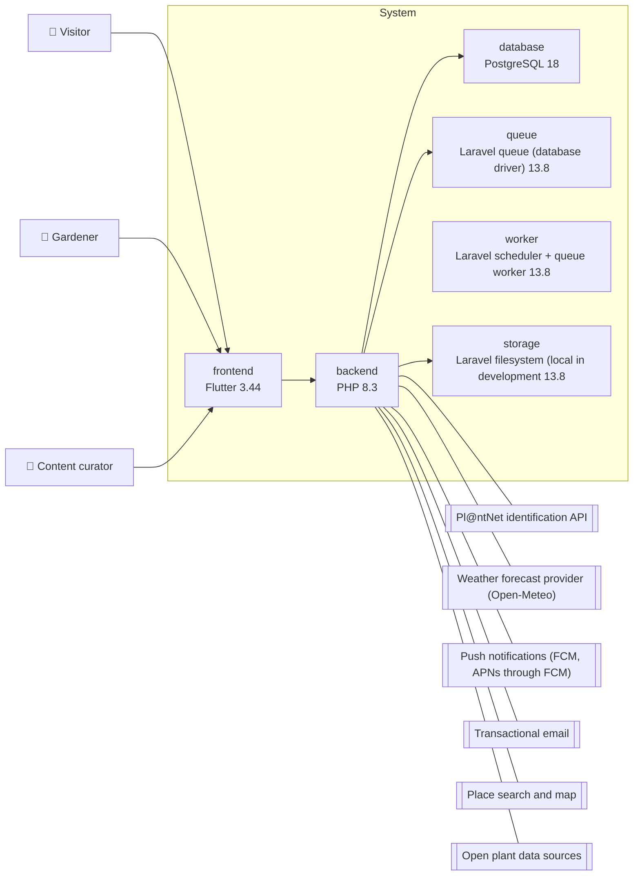
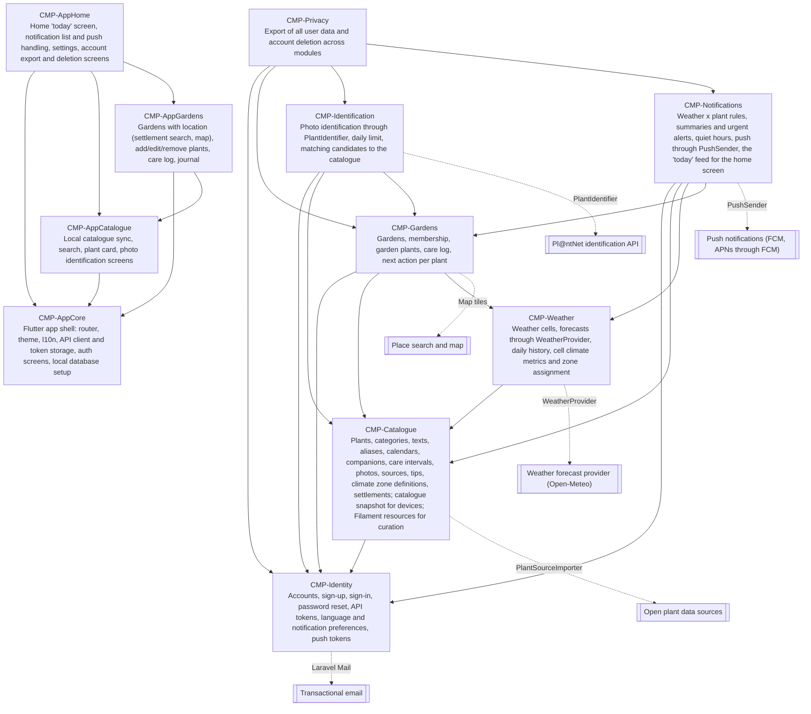

<!-- GENERATED from design/ — do not edit. Rebuild with tools/design/build.py -->
# Architecture and stack

_Generated document · design v1.4.0 · source b5cc50419329_

**Style:** modular-monolith · **database:** postgresql

## Containers

## Stack

| role | technology | version | why |
|---|---|---|---|
| backend | Laravel | 13.8 | Engineer's choice and skills (ARCH-001); one codebase for API, worker and admin panel |
| backend | PHP | 8.3 | Installed on the engineer's machine; minimum for Laravel 13; security support until end of 2027 |
| database | PostgreSQL | 18 | JSONB for forecasts and candidates, partial unique indexes (one summary per garden per day); from the draft |
| queue | Laravel queue (database driver) | 13.8 | No extra service to pay for (ORG-001); switch to Redis when load requires it |
| worker | Laravel scheduler + queue worker | 13.8 | Runs the notification worker every few hours and the morning summaries (UC-008) |
| other | Filament | 5.7 | Admin panel for catalogue curation inside Laravel (SCOPE-010) with built-in MFA (SEC-005) |
| frontend | Riverpod | 3.0 | State management for the Flutter app; widely used and testable (ARCH-004) |
| frontend | Flutter | 3.44 | Mobile app for Android now and iOS later from one codebase (DEC-005); from the draft. 3.44 is the newest verified available (ARCH-005) |
| storage | Laravel filesystem (local in development | 13.8 | Private photo storage with temporary URLs (SEC-002) |

## Components

| id | responsibility | owns | implements | may depend on |
|---|---|---|---|---|
| CMP-Identity | Accounts, sign-up, sign-in, password reset, API tokens, language and notification preferences, push tokens | ENT-User, ENT-PushToken | UC-009, UC-012, UC-013 |  |
| CMP-Catalogue | Plants, categories, texts, aliases, calendars, companions, care intervals, photos, sources, tips, climate zone definitions, settlements; catalogue snapshot for devices; Filament resources for curation | ENT-Plant, ENT-PlantCategory, ENT-PlantTranslation, ENT-PlantAlias, ENT-PlantCalendar, ENT-Companion, ENT-CareInterval, ENT-PlantPhoto, ENT-FactSource, ENT-Tip, ENT-ClimateZone, ENT-Settlement | UC-003, UC-004, UC-010 | CMP-Identity |
| CMP-Weather | Weather cells, forecasts through WeatherProvider, daily history, cell climate metrics and zone assignment | ENT-WeatherCell, ENT-WeatherForecast, ENT-WeatherDaily |  | CMP-Catalogue |
| CMP-Gardens | Gardens, membership, garden plants, care log, next action per plant | ENT-Garden, ENT-GardenMember, ENT-GardenPlant, ENT-CareLog | UC-001, UC-002, UC-007, UC-011, UC-015 | CMP-Identity, CMP-Catalogue, CMP-Weather |
| CMP-Identification | Photo identification through PlantIdentifier, daily limit, matching candidates to the catalogue | ENT-Identification | UC-005 | CMP-Identity, CMP-Catalogue, CMP-Gardens |
| CMP-Notifications | Weather x plant rules, summaries and urgent alerts, quiet hours, push through PushSender, the 'today' feed for the home screen | ENT-Notification | UC-006, UC-008 | CMP-Identity, CMP-Catalogue, CMP-Weather, CMP-Gardens |
| CMP-Privacy | Export of all user data and account deletion across modules |  | UC-014 | CMP-Identity, CMP-Gardens, CMP-Identification, CMP-Notifications |
| CMP-AppCore | Flutter app shell: router, theme, l10n, API client and token storage, auth screens, local database setup |  |  |  |
| CMP-AppCatalogue | Local catalogue sync, search, plant card, photo identification screens |  |  | CMP-AppCore |
| CMP-AppGardens | Gardens with location (settlement search, map), add/edit/remove plants, care log, journal |  |  | CMP-AppCore, CMP-AppCatalogue |
| CMP-AppHome | Home 'today' screen, notification list and push handling, settings, account export and deletion screens |  |  | CMP-AppCore, CMP-AppCatalogue, CMP-AppGardens |

## Approved dependencies

| name | version | scope | provider-specific |
|---|---|---|---|
| laravel/framework | ^13.8 | runtime | False |
| laravel/sanctum | ^4.0 | runtime | False |
| filament/filament | ^5.7 | runtime | False |
| kreait/laravel-firebase | ^7.0 | runtime | False |
| intervention/image | ^3.0 | runtime | False |
| pestphp/pest | ^4.0 | dev | False |
| laravel/pint | ^1.0 | dev | False |
| larastan/larastan | ^3.0 | dev | False |
| deptrac/deptrac | ^3.0 | dev | False |
| flutter_riverpod | ^3.0.0 | runtime | False |
| drift | ^2.28.0 | runtime | False |
| dio | ^5.9.0 | runtime | False |
| intl | ^0.20.0 | runtime | False |
| flutter_map | ^8.0.0 | runtime | False |
| vector_map_tiles | 9.0.0-beta.13 | runtime | False |
| firebase_messaging | ^16.0.0 | runtime | False |
| image_picker | ^1.2.0 | runtime | False |
| flutter_image_compress | ^2.4.0 | runtime | False |
| geolocator | ^14.0.0 | runtime | False |
| flutter_secure_storage | ^9.2.0 | runtime | False |
| flutter_lints | ^6.0.0 | dev | False |

## Conventions

- One repository: backend/ (Laravel) and mobile/ (Flutter); design/, build/, progress/, tools/ at the root
- Backend modules live in backend/app/Modules/<Module>/ and register their own routes, providers, migrations and Filament resources
- A module uses another module only through its public service classes or events, never its models directly
- REST JSON API under /api/v1; errors as RFC 9457 problem details; list endpoints are paginated
- Backend tests with Pest; Pint formatting; Larastan level 6; deptrac enforces may_depend_on
- Mobile: feature-first folders in mobile/lib/features/<feature>/; Riverpod for state; drift for the local catalogue with FTS5 search
- Search keys (accent-free, lower-case, Greeklish transliteration) are computed on the server when the catalogue snapshot is built
- UI strings in ARB files with intl; Greek and English
- External services only behind interfaces: WeatherProvider, PlantIdentifier, PushSender; tests always use fakes
- All dependencies are installed in the foundation phase; a new runtime dependency needs a change request
- The map is used only through one app widget (GardenLocationMap) in CMP-AppGardens; no other code imports flutter_map or vector_map_tiles
- mobile/lib/main.dart is the composition root: the only file that may import both lib/app (CMP-AppCore) and lib/features; it passes each feature's FeatureRoutes to AgrocultApp
- Route names live in AppRoutes (mobile/lib/app/routes.dart, CMP-AppCore) so the shell can navigate by name; features register the screen builders for their routes

## Hotspots (shared files)

- `backend/composer.json`
- `backend/bootstrap/providers.php`
- `backend/routes/console.php`
- `mobile/pubspec.yaml`
- `mobile/lib/l10n/app_el.arb`
- `mobile/lib/l10n/app_en.arb`
- `mobile/lib/app/router.dart`
- `backend/database/seeders/DatabaseSeeder.php`
- `mobile/lib/main.dart`

## Decisions

| id | title | status | decision |
|---|---|---|---|
| ARCH-001 | Backend platform and language | decided | Own backend in PHP Laravel (API + scheduled worker). Versions and supporting services are fixed in area 6. |
| ARCH-002 | Single repository | decided | Backend and mobile app live in one repository (backend/, mobile/) next to the design. |
| ARCH-003 | Catalogue shipped to devices as a SQLite snapshot | decided (inferred) | On every publish the server builds a versioned SQLite snapshot of the published catalogue (with search keys). The app bundles an initial snapshot, checks the current version on start and downloads the whole snapshot when it changed. |
| ARCH-004 | Riverpod for state management | decided (inferred) | The Flutter app uses Riverpod. |
| ARCH-005 | Dependency versions corrected after foundation work | decided | kreait/laravel-firebase ^7.0 (6.x does not support Laravel 13). vector_map_tiles pinned to 9.0.0-beta.13 (no stable 9.x; 8.x needs flutter_map 7). Flutter 3.44, the newest version verified available. |
