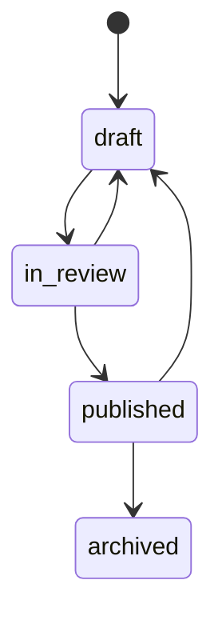
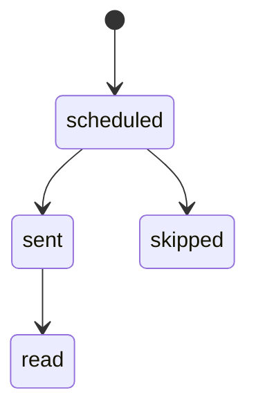

<!-- GENERATED from design/ — do not edit. Rebuild with tools/design/build.py -->
# Data

_Generated document · design v1.2.0 · source 567a799fd2d1_

## Entity–relationship diagram

```mermaid
erDiagram
  Plant {
    uuid id PK
    string scientific_name
    integer gbif_id
    uuid category_id FK
    decimal temp_min_c
    decimal temp_opt_c
    decimal temp_max_c
    integer water_need
    enum sun
    json soil_types
    decimal ph_min
    decimal ph_max
    enum frost_hardiness
    json propagation
    decimal sow_depth_cm
    integer spacing_cm
    integer row_spacing_cm
    integer days_to_harvest
    enum status
    uuid reviewed_by FK
    timestamp reviewed_at
    timestamp published_at
    timestamp updated_at
  }
  PlantCategory {
    uuid id PK
    string code
    string name_el
    string name_en
    uuid parent_id FK
    integer sort_order
  }
  PlantTranslation {
    uuid id PK
    uuid plant_id FK
    enum lang
    string name
    text description
    text planting
    text care
    text seed_saving
    text tips
  }
  PlantAlias {
    uuid id PK
    uuid plant_id FK
    enum lang
    string alias
    enum kind
  }
  ClimateZone {
    uuid id PK
    string code
    string name_el
    string name_en
    text description
    json rules
  }
  PlantCalendar {
    uuid id PK
    uuid plant_id FK
    uuid climate_zone_id FK
    enum activity
    integer month_from
    integer month_to
  }
  Companion {
    uuid id PK
    uuid plant_id FK
    uuid other_plant_id FK
    enum relation
  }
  CareInterval {
    uuid id PK
    uuid plant_id FK
    enum action
    integer interval_days
    integer month_from
    integer month_to
  }
  PlantPhoto {
    uuid id PK
    uuid plant_id FK
    string file_path
    string credit
    string licence
    url source_url
  }
  FactSource {
    uuid id PK
    uuid plant_id FK
    string field
    string source_name
    url source_url
    string licence
    timestamp imported_at
  }
  Tip {
    uuid id PK
    text text_el
    text text_en
    integer month_from
    integer month_to
    uuid climate_zone_id FK
    uuid plant_id FK
    enum status
  }
  Settlement {
    uuid id PK
    string name_el
    string name_en
    string region
    decimal lat
    decimal lon
  }
  User {
    uuid id PK
    email email
    string password_hash
    timestamp email_verified_at
    enum role
    enum language
    json notification_prefs
    text app_authentication_secret
    json app_authentication_recovery_codes
    timestamp created_at
  }
  Garden {
    uuid id PK
    string name
    decimal lat
    decimal lon
    uuid climate_zone_id FK
    uuid weather_cell_id FK
    timestamp created_at
  }
  GardenMember {
    uuid id PK
    uuid garden_id FK
    uuid user_id FK
    enum role
  }
  GardenPlant {
    uuid id PK
    uuid garden_id FK
    uuid plant_id FK
    enum kind
    quantity quantity
    date planted_on
    enum container
    decimal pot_liters
    enum sun_exposure
    text notes
    timestamp archived_at
  }
  CareLog {
    uuid id PK
    uuid garden_plant_id FK
    enum action
    date done_on
    decimal harvest_qty
    enum harvest_unit
    text note
    string photo_path
    timestamp created_at
  }
  Identification {
    uuid id PK
    uuid user_id FK
    uuid garden_id FK
    json candidates
    uuid chosen_plant_id FK
    timestamp created_at
  }
  PushToken {
    uuid id PK
    uuid user_id FK
    string token
    enum platform
    timestamp last_seen_at
  }
  Notification {
    uuid id PK
    uuid user_id FK
    uuid garden_id FK
    enum type
    date for_date
    json payload
    timestamp scheduled_for
    timestamp sent_at
    timestamp read_at
  }
  WeatherCell {
    uuid id PK
    decimal lat
    decimal lon
    integer elevation_m
    decimal winter_min_mean_c
    integer last_frost_doy
    integer first_frost_doy
    uuid climate_zone_id FK
  }
  WeatherForecast {
    uuid id PK
    uuid weather_cell_id FK
    timestamp fetched_at
    json forecast
  }
  WeatherDaily {
    uuid id PK
    uuid weather_cell_id FK
    date day
    decimal rain_mm
    decimal temp_min_c
    decimal temp_max_c
  }
  Plant ||--o{ PlantTranslation : "has texts"
  Plant ||--o{ PlantAlias : "has aliases"
  Plant ||--o{ PlantCalendar : "has calendar"
  Plant ||--o{ Companion : "has companions"
  Plant ||--o{ CareInterval : "has care intervals"
  Plant ||--o{ PlantPhoto : "has photos"
  Plant ||--o{ FactSource : "facts from"
  PlantCategory ||--o{ Plant : "groups"
  User ||--o{ GardenMember : "member of"
  User ||--o{ PushToken : "has devices"
  User ||--o{ Notification : "receives"
  User ||--o{ Identification : "requests"
  Garden ||--o{ GardenMember : "has members"
  Garden ||--o{ GardenPlant : "contains"
  GardenPlant ||--o{ CareLog : "care history"
  WeatherCell ||--o{ WeatherForecast : "has forecasts"
  WeatherCell ||--o{ WeatherDaily : "has daily history"
```

#### ENT-Plant — Catalogue plant with structured fields used by filters and notification rules

Owned by CMP-Catalogue · retention: — · audit: yes

| attribute | type | storage | notes |
|---|---|---|---|
| id | uuid | uuid | primary |
| scientific_name | string | string(255) | required, unique |
| gbif_id | integer | integer | unique |
| category_id | uuid | uuid | → ENT-PlantCategory, required |
| temp_min_c | decimal | decimal |  |
| temp_opt_c | decimal | decimal |  |
| temp_max_c | decimal | decimal |  |
| water_need | integer | integer |  |
| sun | enum | string |  |
| soil_types | json | jsonb |  |
| ph_min | decimal | decimal |  |
| ph_max | decimal | decimal |  |
| frost_hardiness | enum | string |  |
| propagation | json | jsonb |  |
| sow_depth_cm | decimal | decimal |  |
| spacing_cm | integer | integer |  |
| row_spacing_cm | integer | integer |  |
| days_to_harvest | integer | integer |  |
| status | enum | string | required |
| reviewed_by | uuid | uuid | → ENT-User |
| reviewed_at | timestamp | timestamptz |  |
| published_at | timestamp | timestamptz |  |
| updated_at | timestamp | timestamptz |  |

Relations: one-to-many → ENT-PlantTranslation (on delete cascade); one-to-many → ENT-PlantAlias (on delete cascade); one-to-many → ENT-PlantCalendar (on delete cascade); one-to-many → ENT-Companion (on delete cascade); one-to-many → ENT-CareInterval (on delete cascade); one-to-many → ENT-PlantPhoto (on delete cascade); one-to-many → ENT-FactSource (on delete cascade)

States: initial `draft`; allowed transitions: `draft -> in_review`, `in_review -> draft`, `in_review -> published`, `published -> draft`, `published -> archived`

#### ENT-PlantCategory — Curator-managed plant category with an optional parent (DATA-004)

Owned by CMP-Catalogue · retention: — · audit: no

| attribute | type | storage | notes |
|---|---|---|---|
| id | uuid | uuid | primary |
| code | string | string(255) | required, unique |
| name_el | string | string(255) | required |
| name_en | string | string(255) | required |
| parent_id | uuid | uuid | → ENT-PlantCategory |
| sort_order | integer | integer |  |

Relations: one-to-many → ENT-Plant (on delete restrict)

#### ENT-PlantTranslation — Texts of a plant in one language (one row per language, so a third language needs no schema change)

Owned by CMP-Catalogue · retention: — · audit: no

| attribute | type | storage | notes |
|---|---|---|---|
| id | uuid | uuid | primary |
| plant_id | uuid | uuid | → ENT-Plant, required |
| lang | enum | string | required |
| name | string | string(255) | required |
| description | text | text |  |
| planting | text | text |  |
| care | text | text |  |
| seed_saving | text | text |  |
| tips | text | text |  |

#### ENT-PlantAlias — Synonyms, local names and Greeklish spellings used by search

Owned by CMP-Catalogue · retention: — · audit: no

| attribute | type | storage | notes |
|---|---|---|---|
| id | uuid | uuid | primary |
| plant_id | uuid | uuid | → ENT-Plant, required |
| lang | enum | string |  |
| alias | string | string(255) | required |
| kind | enum | string |  |

#### ENT-ClimateZone — One of 4-5 named climate zones of Greece; drives the sowing calendar and season notifications (DATA-001)

Owned by CMP-Catalogue · retention: — · audit: no

| attribute | type | storage | notes |
|---|---|---|---|
| id | uuid | uuid | primary |
| code | string | string(255) | required, unique |
| name_el | string | string(255) | required |
| name_en | string | string(255) | required |
| description | text | text |  |
| rules | json | jsonb | required |

#### ENT-PlantCalendar — Month ranges for sowing, transplanting and harvest per climate zone

Owned by CMP-Catalogue · retention: — · audit: no

| attribute | type | storage | notes |
|---|---|---|---|
| id | uuid | uuid | primary |
| plant_id | uuid | uuid | → ENT-Plant, required |
| climate_zone_id | uuid | uuid | → ENT-ClimateZone, required |
| activity | enum | string | required |
| month_from | integer | integer | required |
| month_to | integer | integer | required |

#### ENT-Companion — Good or bad neighbour relation between two plants

Owned by CMP-Catalogue · retention: — · audit: no

| attribute | type | storage | notes |
|---|---|---|---|
| id | uuid | uuid | primary |
| plant_id | uuid | uuid | → ENT-Plant, required |
| other_plant_id | uuid | uuid | → ENT-Plant, required |
| relation | enum | string | required |

#### ENT-CareInterval — How often a care action is due for a plant, optionally only in some months (DEC-004)

Owned by CMP-Catalogue · retention: — · audit: no

| attribute | type | storage | notes |
|---|---|---|---|
| id | uuid | uuid | primary |
| plant_id | uuid | uuid | → ENT-Plant, required |
| action | enum | string | required |
| interval_days | integer | integer | required |
| month_from | integer | integer |  |
| month_to | integer | integer |  |

#### ENT-PlantPhoto — Catalogue photo with credit and licence

Owned by CMP-Catalogue · retention: — · audit: no

| attribute | type | storage | notes |
|---|---|---|---|
| id | uuid | uuid | primary |
| plant_id | uuid | uuid | → ENT-Plant, required |
| file_path | string | string(255) | required |
| credit | string | string(255) | required |
| licence | string | string(255) | required |
| source_url | url | string(2048) |  |

#### ENT-FactSource — Provenance of imported catalogue facts (SCOPE-001)

Owned by CMP-Catalogue · retention: — · audit: no

| attribute | type | storage | notes |
|---|---|---|---|
| id | uuid | uuid | primary |
| plant_id | uuid | uuid | → ENT-Plant, required |
| field | string | string(255) | required |
| source_name | string | string(255) | required |
| source_url | url | string(2048) |  |
| licence | string | string(255) | required |
| imported_at | timestamp | timestamptz |  |

#### ENT-Tip — Short tip or fact for the home screen, optionally tied to months, a climate zone or a plant

Owned by CMP-Catalogue · retention: — · audit: no

| attribute | type | storage | notes |
|---|---|---|---|
| id | uuid | uuid | primary |
| text_el | text | text | required |
| text_en | text | text | required |
| month_from | integer | integer |  |
| month_to | integer | integer |  |
| climate_zone_id | uuid | uuid | → ENT-ClimateZone |
| plant_id | uuid | uuid | → ENT-Plant |
| status | enum | string |  |

#### ENT-Settlement — Greek settlement for area search, derived from OpenStreetMap and bundled in the app

Owned by CMP-Catalogue · retention: — · audit: no

| attribute | type | storage | notes |
|---|---|---|---|
| id | uuid | uuid | primary |
| name_el | string | string(255) | required |
| name_en | string | string(255) |  |
| region | string | string(255) |  |
| lat | decimal | decimal | required |
| lon | decimal | decimal | required |

#### ENT-User — Account of a gardener or curator

Owned by CMP-Identity · retention: Until account deletion (immediate hard delete, DEC-004) · audit: no

| attribute | type | storage | notes |
|---|---|---|---|
| id | uuid | uuid | primary |
| email | email | string(254) | required, unique, personal |
| password_hash | string | string(255) | required, sensitive |
| email_verified_at | timestamp | timestamptz |  |
| role | enum | string | required |
| language | enum | string | required |
| notification_prefs | json | jsonb |  |
| app_authentication_secret | text | text | sensitive |
| app_authentication_recovery_codes | json | jsonb | sensitive |
| created_at | timestamp | timestamptz |  |

Relations: one-to-many → ENT-GardenMember (on delete cascade); one-to-many → ENT-PushToken (on delete cascade); one-to-many → ENT-Notification (on delete cascade); one-to-many → ENT-Identification (on delete cascade)

#### ENT-Garden — A garden with its own approximate location, climate zone and weather cell

Owned by CMP-Gardens · retention: Until the garden or the account is deleted (immediate hard delete) · audit: no

| attribute | type | storage | notes |
|---|---|---|---|
| id | uuid | uuid | primary |
| name | string | string(255) | required |
| lat | decimal | decimal | personal |
| lon | decimal | decimal | personal |
| climate_zone_id | uuid | uuid | → ENT-ClimateZone |
| weather_cell_id | uuid | uuid | → ENT-WeatherCell |
| created_at | timestamp | timestamptz |  |

Relations: one-to-many → ENT-GardenMember (on delete cascade); one-to-many → ENT-GardenPlant (on delete cascade)

#### ENT-GardenMember — Link between a user and a garden; MVP has exactly one owner per garden, shared gardens later (SCOPE-007)

Owned by CMP-Gardens · retention: Deleted with the garden or the user · audit: no

| attribute | type | storage | notes |
|---|---|---|---|
| id | uuid | uuid | primary |
| garden_id | uuid | uuid | → ENT-Garden, required |
| user_id | uuid | uuid | → ENT-User, required |
| role | enum | string | required |

#### ENT-GardenPlant — A plant, seed or tree in a garden

Owned by CMP-Gardens · retention: Until the garden or the account is deleted · audit: no

| attribute | type | storage | notes |
|---|---|---|---|
| id | uuid | uuid | primary |
| garden_id | uuid | uuid | → ENT-Garden, required |
| plant_id | uuid | uuid | → ENT-Plant, required |
| kind | enum | string | required |
| quantity | quantity | integer | required |
| planted_on | date | date | required |
| container | enum | string | required |
| pot_liters | decimal | decimal |  |
| sun_exposure | enum | string |  |
| notes | text | text | personal |
| archived_at | timestamp | timestamptz |  |

Relations: one-to-many → ENT-CareLog (on delete cascade)

#### ENT-CareLog — A dated care action; also the garden journal from which next actions and season comparisons come

Owned by CMP-Gardens · retention: Until the garden or the account is deleted · audit: no

| attribute | type | storage | notes |
|---|---|---|---|
| id | uuid | uuid | primary |
| garden_plant_id | uuid | uuid | → ENT-GardenPlant, required |
| action | enum | string | required |
| done_on | date | date | required |
| harvest_qty | decimal | decimal |  |
| harvest_unit | enum | string |  |
| note | text | text | personal |
| photo_path | string | string(255) | personal |
| created_at | timestamp | timestamptz |  |

#### ENT-Identification — A photo identification request; used for the 10/day limit and result caching

Owned by CMP-Identification · retention: 30 days; the photo itself is not stored after the provider call · audit: no

| attribute | type | storage | notes |
|---|---|---|---|
| id | uuid | uuid | primary |
| user_id | uuid | uuid | → ENT-User, required |
| garden_id | uuid | uuid | → ENT-Garden |
| candidates | json | jsonb |  |
| chosen_plant_id | uuid | uuid | → ENT-Plant |
| created_at | timestamp | timestamptz | required |

#### ENT-PushToken — Device push token of a user

Owned by CMP-Identity · retention: Until sign-out, invalidation by FCM, or account deletion · audit: no

| attribute | type | storage | notes |
|---|---|---|---|
| id | uuid | uuid | primary |
| user_id | uuid | uuid | → ENT-User, required |
| token | string | string(255) | required, unique, personal |
| platform | enum | string |  |
| last_seen_at | timestamp | timestamptz |  |

#### ENT-Notification — A notification produced by the rules, shown in the app and pushed to devices

Owned by CMP-Notifications · retention: 90 days, and deleted with the account · audit: no

| attribute | type | storage | notes |
|---|---|---|---|
| id | uuid | uuid | primary |
| user_id | uuid | uuid | → ENT-User, required |
| garden_id | uuid | uuid | → ENT-Garden |
| type | enum | string | required |
| for_date | date | date | required |
| payload | json | jsonb |  |
| scheduled_for | timestamp | timestamptz |  |
| sent_at | timestamp | timestamptz |  |
| read_at | timestamp | timestamptz |  |

States: initial `scheduled`; allowed transitions: `scheduled -> sent`, `scheduled -> skipped`, `sent -> read`

#### ENT-WeatherCell — Grid cell of about 10 km; one forecast per cell serves all its gardens

Owned by CMP-Weather · retention: — · audit: no

| attribute | type | storage | notes |
|---|---|---|---|
| id | uuid | uuid | primary |
| lat | decimal | decimal | required |
| lon | decimal | decimal | required |
| elevation_m | integer | integer |  |
| winter_min_mean_c | decimal | decimal |  |
| last_frost_doy | integer | integer |  |
| first_frost_doy | integer | integer |  |
| climate_zone_id | uuid | uuid | → ENT-ClimateZone |

Relations: one-to-many → ENT-WeatherForecast (on delete cascade); one-to-many → ENT-WeatherDaily (on delete cascade)

#### ENT-WeatherForecast — Cached forecast of one weather cell

Owned by CMP-Weather · retention: 7 days · audit: no

| attribute | type | storage | notes |
|---|---|---|---|
| id | uuid | uuid | primary |
| weather_cell_id | uuid | uuid | → ENT-WeatherCell, required |
| fetched_at | timestamp | timestamptz | required |
| forecast | json | jsonb | required |

#### ENT-WeatherDaily — Permanent daily weather summary per cell, for season insights (DATA-007)

Owned by CMP-Weather · retention: Permanent (not personal data) · audit: no

| attribute | type | storage | notes |
|---|---|---|---|
| id | uuid | uuid | primary |
| weather_cell_id | uuid | uuid | → ENT-WeatherCell, required |
| day | date | date | required |
| rain_mm | decimal | decimal |  |
| temp_min_c | decimal | decimal |  |
| temp_max_c | decimal | decimal |  |

## Decisions

| id | title | status | decision |
|---|---|---|---|
| DATA-001 | Climate zones computed per weather cell from historical data | decided (inferred) | Each weather cell gets climate metrics from the Open-Meteo historical archive (mean winter minimum temperature, mean last spring frost and first autumn frost dates, elevation). The metrics map the cell to one of 4-5 named climate zones; gardens take the zone of their cell. Zone thresholds and names are curator-managed data. |
| DATA-002 | Plants in the first catalogue | decided (inferred) | 42 plants in 10 categories (list in rationale). |
| DATA-003 | The owner reviews content in the MVP | decided (inferred) | The owner reviews and publishes catalogue content in the MVP; an agronomist joins as curator when available. Weather thresholds remain initial values until an agronomist checks them. |
| DATA-004 | Plant categories as curator-managed data | decided | Categories are a catalogue table with Greek and English names and an optional parent, so curators can add or regroup them. Each plant has one primary category; search filters by category. |
| DATA-005 | Removing a garden plant archives it | decided (inferred) | Removing a plant from a garden sets archived_at; it disappears from the garden and produces no notifications, its care log stays for season comparison. Deleting a garden or an account still hard-deletes everything. |
| DATA-006 | Data model defaults | decided (default) | UUID keys; UTC timestamps; ISO language codes; identification photos not stored, results kept 30 days; forecasts kept 7 days, notifications 90 days; user data until account deletion; owners may edit or delete their care log entries; tips in Greek and English; audit trail on catalogue plant changes. |
| DATA-007 | Personal season insights | deferred (inferred) | A 'My season' view with the user's own statistics (planting dates year over year, care actions per month and plant, watering vs rain, harvest per plant and season) comes after the MVP; the MVP stores what it needs. |
| DATA-008 | Anonymous regional insights from all users | deferred | Aggregated, anonymised activity by area (e.g. 'gardeners near you are sowing garlic now') is a post-MVP idea. |
