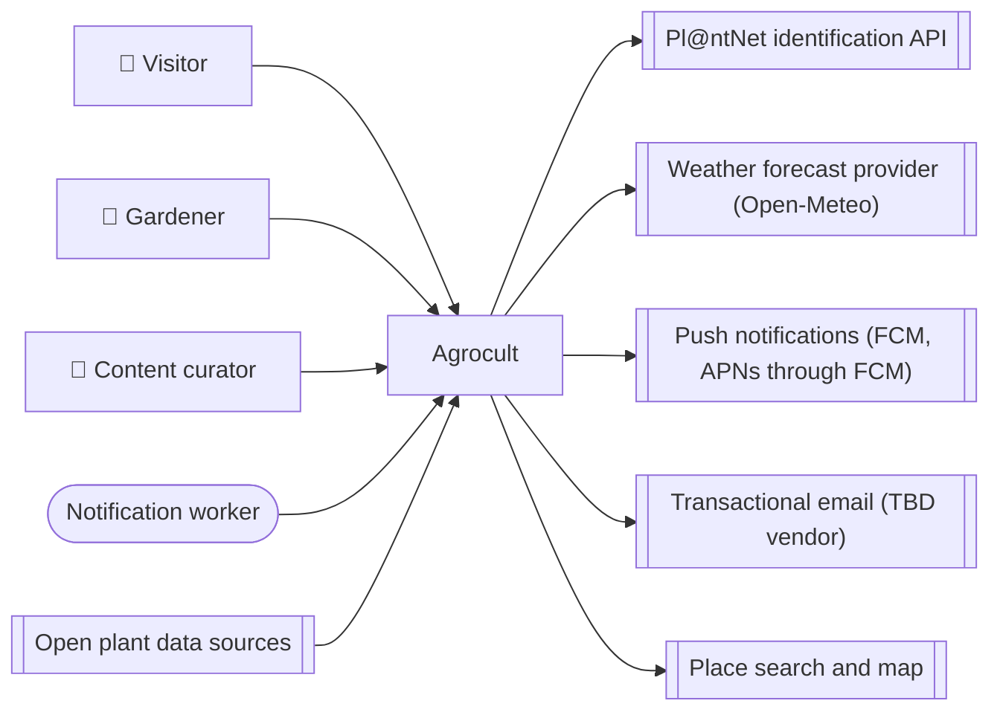

<!-- GENERATED from design/ — do not edit. Rebuild with tools/design/build.py -->
# External systems and constraints

_Generated document · design v1.1.0 · source 26e0c15630c0_

## Context diagram

### EXT-001 — Pl@ntNet identification API

Identify plant species from a photo · direction: outbound · owner: third-party · vendor: Pl@ntNet

Imposed:
- Free tier: 500 identifications per day
- Attribution is mandatory wherever results are shown
- Commercial-use terms must be confirmed with the Pl@ntNet team before a commercial release
- API key must stay on the server

Prepare now:
- MUST call plant identification only through a PlantIdentifier interface on the server
- MUST NOT expose provider-specific types outside the identification adapter

| environment | mode | tool | config vars |
|---|---|---|---|
| development | live | Pl@ntNet free key | PLANTNET_API_KEY |

### EXT-002 — Weather forecast provider (Open-Meteo)

Forecast per weather cell (rain mm, min/max temperature) for notification rules and home screen; historical data for frost dates · direction: outbound · owner: third-party · vendor: Open-Meteo

Imposed:
- Free tier is for non-commercial use only; a commercial release needs the paid plan or another provider (e.g. MET Norway)
- Free tier daily call limit (~10,000/day at the time of design; verify)
- Attribution required (CC BY 4.0 data)

Prepare now:
- MUST access weather only through a WeatherProvider interface
- MUST cache forecasts per weather cell and never call the provider per garden

| environment | mode | tool | config vars |
|---|---|---|---|
| development | live | Open-Meteo free API (no key) | OPEN_METEO_BASE_URL |

### EXT-003 — Push notifications (FCM, APNs through FCM)

Deliver summaries and urgent alerts to devices · direction: outbound · owner: third-party · vendor: Firebase Cloud Messaging

Imposed:
- iOS delivery requires an Apple Developer account and an APNs key uploaded to Firebase
- Invalid tokens are reported back and must be removed

Prepare now:
- MUST send push only through a PushSender interface

| environment | mode | tool | config vars |
|---|---|---|---|
| development | live | Firebase dev project | FIREBASE_CREDENTIALS |

### EXT-004 — Transactional email _(deferred)_

Email verification and password reset · direction: outbound · owner: third-party

Requirements for the choice:
- Free tier of at least ~100 emails/day
- EU delivery
- SMTP or Laravel mail driver

Prepare now:
- MUST send email only through Laravel Mail

| environment | mode | tool | config vars |
|---|---|---|---|
| development | catcher | Mailtrap Email Sandbox (free plan) | MAIL_* |

### EXT-005 — Place search and map

Find an area by name from a bundled list of Greek settlements; pick a point on a map · direction: outbound · owner: third-party · vendor: Bundled Greek settlements list derived from OpenStreetMap (ODbL); OpenFreeMap vector tiles

Imposed:
- OpenStreetMap attribution must be shown on the map and in the app's credits (ODbL)
- Settlement list is bundled in the app and works offline; the map needs network

Prepare now:
- MUST load map tiles through a configurable tile URL so that the tile provider can change without a code change

| environment | mode | tool | config vars |
|---|---|---|---|
| development | live | OpenFreeMap public tiles | MAP_TILE_URL |

### EXT-006 — Open plant data sources

One-off and occasional import of plant facts by curators (OpenFarm crops rescue CC0, Wikidata/Wikipedia, GBIF ids, Trefle taxonomy) · direction: inbound · owner: third-party · vendor: OpenFarm (CC0), Wikidata, GBIF, Trefle

Imposed:
- Facts only; source texts are never copied
- Source and licence recorded per imported fact (SCOPE-001)
- Perenual excluded: free tier is non-commercial only
- Permapeople excluded: CC BY-SA share-alike would bind the catalogue to the same licence

| environment | mode | tool | config vars |
|---|---|---|---|
| development | live |  | TREFLE_TOKEN |

## Organisational constraints

| id | constraint |
|---|---|
| ORG-001 | Budget: free tiers wherever possible |

## Decisions

| id | title | status | decision |
|---|---|---|---|
| DEC-001 | Weather provider | decided (inferred) | Open-Meteo free API while the project is personal; switch to its paid plan or MET Norway before any commercial release. |
| DEC-005 | Android first, iOS later | deferred (inferred) | The MVP is released on Android only; iOS follows later. |
| DEC-006 | No Permapeople data | decided (inferred) | Permapeople is not used as a data source; companion data comes from OpenFarm (CC0). |
