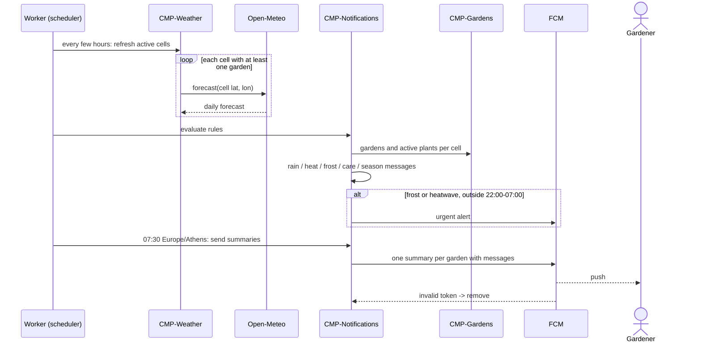
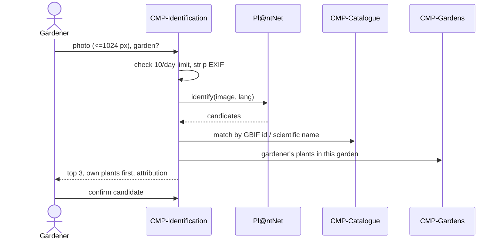
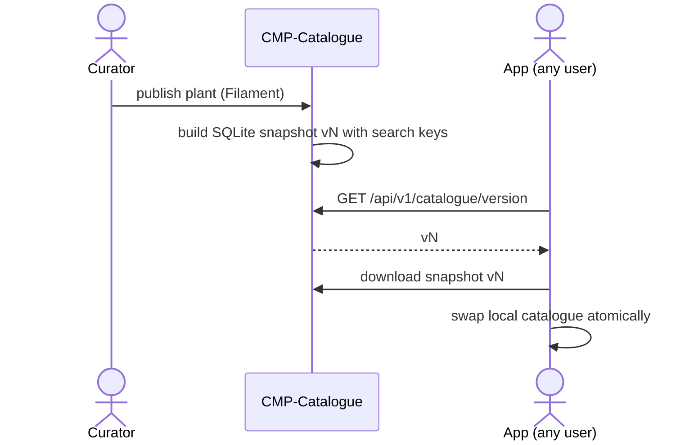

<!-- GENERATED from design/ — do not edit. Rebuild with tools/design/build.py -->
# Integrations

_Generated document · design v1.2.0 · source 567a799fd2d1_

#### PlantIdentifier (INT-001: CMP-Identification ↔ EXT-001)

Mechanism: Laravel HTTP client in a Pl@ntNet adapter behind PlantIdentifier; called synchronously from the identification request after resizing and EXIF stripping

Operations:
- `identify(image, lang, lat?, lon?) -> Candidate[] (scientific_name, gbif_id, confidence)`

Failure policy: timeout 15s, retries 1, after 1s, idempotency key —; when unavailable: The app shows 'identification is temporarily unavailable' (UC-005); the photo is discarded; the failed attempt does not count against the 10/day limit

#### WeatherProvider (INT-002: CMP-Weather ↔ EXT-002)

Mechanism: Laravel HTTP client in an Open-Meteo adapter behind WeatherProvider; called from queued jobs, one per weather cell

Operations:
- `forecast(lat, lon, days) -> DailyForecast[] (date, rain_mm, temp_min_c, temp_max_c)`
- `history(lat, lon, from, to) -> DailyWeather[]`
- `elevation(lat, lon) -> integer`

Failure policy: timeout 10s, retries 3, exponential backoff via queue (30s, 2m, 10m), idempotency key —; when unavailable: The last forecast of the cell is used if it is less than 12 hours old; otherwise weather rules are skipped for that run and the home screen shows 'weather currently unavailable' while care and season messages still work (UC-006, UC-008)

#### PushSender (INT-003: CMP-Notifications ↔ EXT-003)

Mechanism: kreait/laravel-firebase behind PushSender; sent from queued jobs

Operations:
- `send(token, title, body, data) -> SendResult (sent | invalid_token | failed)`

Failure policy: timeout 10s, retries 3, exponential backoff via queue, idempotency key —; when unavailable: Notifications stay in the app's notification list; pushes are retried; a summary push not sent by 10:00 Europe/Athens is dropped and stays in-app only; an urgent alert that cannot be sent before 22:00 waits for 07:00

#### Laravel Mail (INT-004: CMP-Identity ↔ EXT-004)

Mechanism: Laravel Mail over SMTP, queued; Mailtrap sandbox in development

Operations:
- `sendVerification(user_id)`
- `sendPasswordReset(user_id)`

Failure policy: timeout 15s, retries 5, exponential backoff via queue, idempotency key —; when unavailable: Emails stay queued and are retried; the user can request a new verification or reset email from the app

#### Map tiles (INT-005: CMP-Gardens ↔ EXT-005)

Mechanism: The mobile app loads vector tiles directly from MAP_TILE_URL; the settlement list is in the bundled catalogue snapshot

Operations:
- `GET {MAP_TILE_URL}/{z}/{x}/{y}`

Failure policy: timeout 10s, retries none (the map library retries tiles), idempotency key —; when unavailable: The map shows an offline message; area search from the settlement list still works

#### PlantSourceImporter (INT-006: CMP-Catalogue ↔ EXT-006)

Mechanism: Artisan import commands run by the owner; results land as draft plants with FactSource rows

Operations:
- `import(source, scientific_name) -> DraftFacts`

Failure policy: timeout 30s, retries manual re-run, idempotency key —; when unavailable: The import stops with a message; nothing is published

## Flows

### FLOW-001 — Worker run and morning summary

### FLOW-002 — Photo identification

### FLOW-003 — Catalogue publish and device sync

## Decisions

| id | title | status | decision |
|---|---|---|---|
| DEC-007 | Failure behaviour of identification and summaries | decided (inferred) | Only identifications that returned a provider result count against the 10/day limit. A morning summary not pushed by 10:00 Europe/Athens is not pushed and stays visible in the app. Calls to third parties are logged with duration and outcome, never personal data. Mocks simulate timeouts and errors. |
