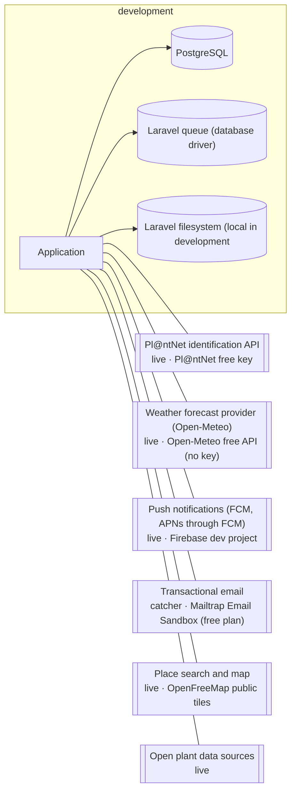

<!-- GENERATED from design/ — do not edit. Rebuild with tools/design/build.py -->
# Deployment and operations

_Generated document · design v1.2.0 · source 567a799fd2d1_

## Environment: development

## Targets

| target | value |
|---|---|
| rpo | 24h |
| rto | 48h |
| availability | best effort (~99%) |
| alerts_to | Owner's email |
| release | backend: manual deploy with a short maintenance window; mobile: Google Play internal testing -> closed testing -> production |

## Backups

| setting | value |
|---|---|
| frequency | 24h |
| retention | 14 days |
| restore_test | quarterly |
| offsite | S3-compatible free tier bucket |

## CI/CD stages

1. lint (Pint
2. flutter analyze)
3. backend tests (Pest)
4. mobile tests (flutter test)
5. architecture tests (deptrac)
6. design check (tools/design/ci_check.py)
7. dependency audit (composer audit)
8. build Android app bundle

## Hosting — OPS-002 _(deferred)_

Not decided yet.

### Infrastructure requirements

- EU region (SEC-002)
- Free or near-free (ORG-001)
- PHP 8.3, PostgreSQL 18, a long-running queue worker and cron (scheduler)
- ~1 vCPU / 2 GB RAM at launch; ~10 GB database and ~20 GB photo storage in the first year
- Public HTTPS endpoint with certificate

## Decisions

| id | title | status | decision |
|---|---|---|---|
| OPS-001 | App store distribution | decided (inferred) | Android app distributed through Google Play (one-time developer fee); iOS through the App Store later (DEC-005). Both need a privacy policy and data-safety / privacy labels declaring location, photos and email. |
| OPS-002 | Production hosting | deferred (inferred) | → before first production deploy |
| OPS-003 | Code on GitHub, CI with GitHub Actions | decided | The repository is hosted on GitHub; CI runs on GitHub Actions on every push and pull request. |
| OPS-004 | Docker development environment | decided | Development runs in Docker via Laravel Sail: PHP 8.3, PostgreSQL 18 and the queue worker and scheduler as services. The Flutter app runs on the host against the Sail API. |
