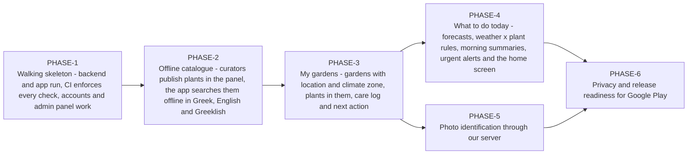
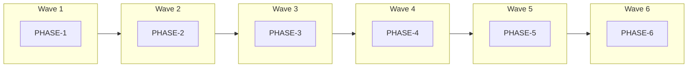
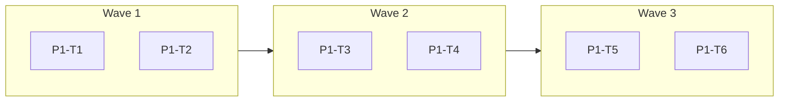
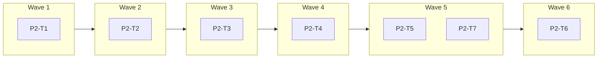
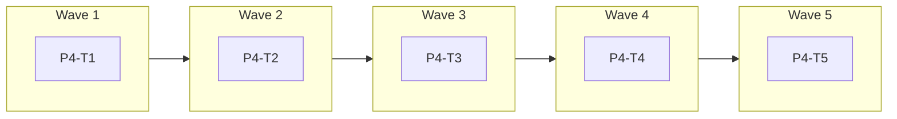
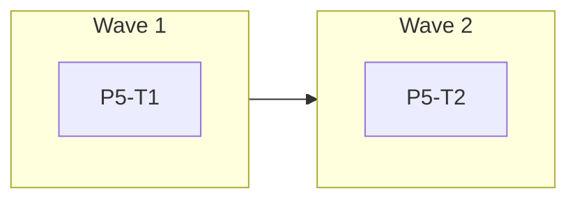
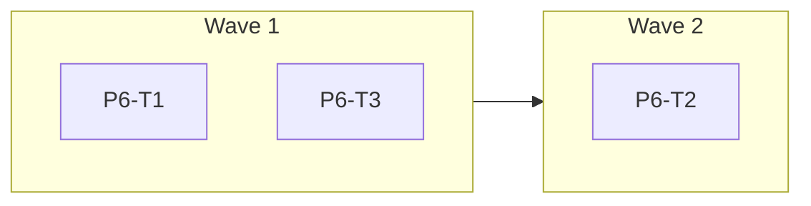

<!-- GENERATED from design/ — do not edit. Rebuild with tools/design/build.py -->
# Implementation phases

_Generated document · design v1.2.0 · source 567a799fd2d1_

## Phase map

## Phases that can run in parallel

- PHASE-5 serialised after PHASE-4 (hotspot mobile/lib/app/router.dart, mobile/lib/l10n/app_el.arb, mobile/lib/l10n/app_en.arb)

## Use case coverage

| use case | title | priority | phases |
|---|---|---|---|
| UC-001 | Manage gardens | must | PHASE-3 |
| UC-002 | Add plant to garden | must | PHASE-3 |
| UC-003 | Search catalogue | must | PHASE-2 |
| UC-004 | View plant card | must | PHASE-2 |
| UC-005 | Identify plant by photo | must | PHASE-5 |
| UC-006 | View today's home screen | must | PHASE-4 |
| UC-007 | Log care action | must | PHASE-3 |
| UC-008 | Receive weather and care notifications | must | PHASE-4 |
| UC-009 | Change settings | must | PHASE-4 |
| UC-010 | Curate catalogue content | must | PHASE-2 |
| UC-011 | Edit or remove garden plant | must | PHASE-3 |
| UC-012 | Sign up and sign in | must | PHASE-1 |
| UC-013 | Reset password | must | PHASE-1 |
| UC-014 | Delete account and export my data | must | PHASE-6 |
| UC-015 | View garden journal | should | PHASE-3 |

## PHASE-1 — Walking skeleton - backend and app run, CI enforces every check, accounts and admin panel work

Depends on: none · use cases: UC-012, UC-013 · environment: development

| task | title | depends on | writes | migrations |
|---|---|---|---|---|
| P1-T1 | Backend skeleton in Docker | — | — |  |
| P1-T2 | Mobile app skeleton | — | CMP-AppCore |  |
| P1-T3 | CI pipeline | P1-T1, P1-T2 | — |  |
| P1-T4 | Accounts API | P1-T1 | CMP-Identity | yes |
| P1-T5 | Admin panel with MFA | P1-T4 | CMP-Identity | yes |
| P1-T6 | Auth screens in the app | P1-T2, P1-T4 | CMP-AppCore |  |

Task waves:

Out of scope:
- Catalogue (PHASE-2)
- Social login (SCOPE-009)
- Production hosting (OPS-002)
- iOS build (DEC-005)

## PHASE-2 — Offline catalogue - curators publish plants in the panel, the app searches them offline in Greek, English and Greeklish

Depends on: PHASE-1 · use cases: UC-003, UC-004, UC-010 · environment: development

| task | title | depends on | writes | migrations |
|---|---|---|---|---|
| P2-T1 | Catalogue model | — | CMP-Catalogue | yes |
| P2-T2 | Curation in the admin panel | P2-T1 | CMP-Catalogue |  |
| P2-T3 | Import commands | P2-T2 | CMP-Catalogue |  |
| P2-T4 | Catalogue snapshot and sync API | P2-T3 | CMP-Catalogue |  |
| P2-T5 | Local catalogue in the app | P2-T4 | CMP-AppCatalogue |  |
| P2-T6 | Search and plant card | P2-T5 | CMP-AppCatalogue |  |
| P2-T7 | Demo seeder | P2-T4 | CMP-Catalogue |  |

Task waves:

Out of scope:
- Entering the 42 plants' content (curation work by the owner, not a task; P2-T7 demo content does not count toward it)
- Photo identification (PHASE-5)
- Gardens (PHASE-3)

## PHASE-3 — My gardens - gardens with location and climate zone, plants in them, care log and next action

Depends on: PHASE-2 · use cases: UC-001, UC-002, UC-007, UC-011, UC-015 · environment: development

| task | title | depends on | writes | migrations |
|---|---|---|---|---|
| P3-T1 | Weather cells and climate zones | — | CMP-Weather | yes |
| P3-T2 | Gardens API | P3-T1 | CMP-Gardens | yes |
| P3-T3 | Gardens screens | P3-T2 | CMP-AppGardens |  |
| P3-T4 | Add, edit and remove garden plants | P3-T3 | CMP-AppGardens |  |
| P3-T5 | Care log and journal screens | P3-T4 | CMP-AppGardens |  |

Task waves:

Out of scope:
- Forecasts and notifications (PHASE-4)
- Shared gardens (SCOPE-007)
- Season insights (DATA-007)

## PHASE-4 — What to do today - forecasts, weather x plant rules, morning summaries, urgent alerts and the home screen

Depends on: PHASE-3 · use cases: UC-006, UC-008, UC-009 · environment: development

| task | title | depends on | writes | migrations |
|---|---|---|---|---|
| P4-T1 | Forecast refresh | — | CMP-Weather | yes |
| P4-T2 | Notification rules | — | CMP-Notifications | yes |
| P4-T3 | Push delivery | P4-T2 | CMP-Notifications |  |
| P4-T4 | Today feed API | P4-T2 | CMP-Notifications |  |
| P4-T5 | Home, notifications and settings screens | P4-T3, P4-T4 | CMP-AppHome |  |

Task waves:

Serialised:
- P4-T2 serialised after P4-T1 (hotspot backend/routes/console.php)
- P4-T4 serialised after P4-T3 (writes CMP-Notifications)

Out of scope:
- Spraying alerts and vacation mode (SCOPE-007)
- Home-screen widget (SCOPE-007)

## PHASE-5 — Photo identification through our server

Depends on: PHASE-3 · use cases: UC-005 · environment: development

| task | title | depends on | writes | migrations |
|---|---|---|---|---|
| P5-T1 | Identification API | — | CMP-Identification | yes |
| P5-T2 | Identification screens | P5-T1 | CMP-AppCatalogue |  |

Task waves:

Out of scope:
- Disease diagnosis (non-goal)

## PHASE-6 — Privacy and release readiness for Google Play

Depends on: PHASE-4, PHASE-5 · use cases: UC-014 · environment: development

| task | title | depends on | writes | migrations |
|---|---|---|---|---|
| P6-T1 | Export and account deletion API | — | CMP-Privacy |  |
| P6-T2 | Export and deletion screens | P6-T1 | CMP-AppHome |  |
| P6-T3 | Release readiness | — | CMP-AppCore |  |

Task waves:

Out of scope:
- Choosing and setting up production hosting (OPS-002, before first production deploy)
- iOS release (DEC-005)
