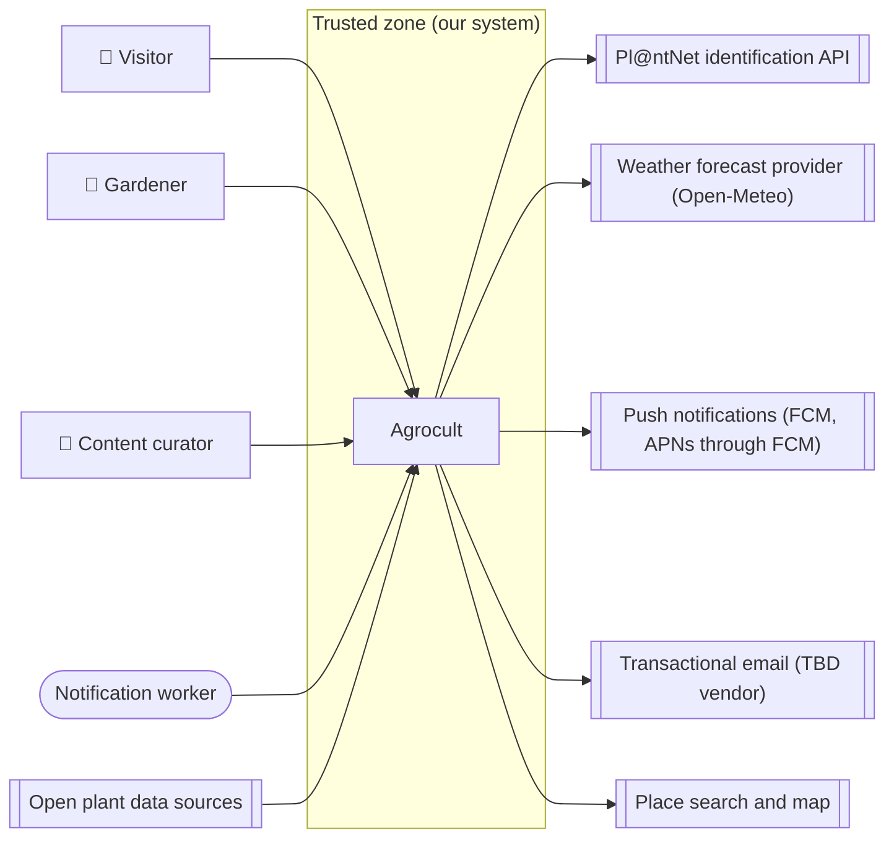

<!-- GENERATED from design/ — do not edit. Rebuild with tools/design/build.py -->
# Security and compliance

_Generated document · design v1.0.0 · source e80104843be7_

## Trust boundaries

## Roles

| id | from actor | MFA |
|---|---|---|
| ROLE-Visitor | ACT-Visitor | — |
| ROLE-Gardener | ACT-Gardener | none |
| ROLE-Curator | ACT-Curator | required |
| ROLE-Worker | ACT-Worker | — |

## Permission matrix

| use case | ROLE-Visitor | ROLE-Gardener | ROLE-Curator | ROLE-Worker |
|---|---|---|---|---|
| UC-001 Manage gardens |  | ✓ |  |  |
| UC-002 Add plant to garden |  | ✓ |  |  |
| UC-003 Search catalogue | ✓ | ✓ |  |  |
| UC-004 View plant card | ✓ | ✓ |  |  |
| UC-005 Identify plant by photo |  | ✓ |  |  |
| UC-006 View today's home screen | ✓ | ✓ |  |  |
| UC-007 Log care action |  | ✓ |  |  |
| UC-008 Receive weather and care notifications |  | ✓ |  | ✓ |
| UC-009 Change settings |  | ✓ |  |  |
| UC-010 Curate catalogue content |  |  | ✓ |  |
| UC-011 Edit or remove garden plant |  | ✓ |  |  |
| UC-012 Sign up and sign in | ✓ | ✓ | ✓ |  |
| UC-013 Reset password |  | ✓ | ✓ |  |
| UC-014 Delete account and export my data |  | ✓ |  |  |
| UC-015 View garden journal |  | ✓ |  |  |

## Ownership rules

| id | entity | rule | applies to |
|---|---|---|---|
| OWN-001 | ENT-Garden | A gardener reads and changes only gardens where they have a GardenMember row | ROLE-Gardener |
| OWN-002 | ENT-GardenPlant | A gardener reads and changes only plants of gardens they are a member of | ROLE-Gardener |
| OWN-003 | ENT-CareLog | A gardener reads and changes only care log entries of plants in gardens they are a member of | ROLE-Gardener |
| OWN-004 | ENT-Notification | A gardener reads only notifications where user_id is their own id | ROLE-Gardener |
| OWN-005 | ENT-PushToken | A gardener registers and removes only their own push tokens | ROLE-Gardener |
| OWN-006 | ENT-Identification | A gardener reads only their own identification requests | ROLE-Gardener |
| OWN-007 | ENT-User | A gardener reads, changes, exports and deletes only their own account | ROLE-Gardener |
| OWN-008 | ENT-GardenMember | A gardener sees only memberships of gardens they are a member of | ROLE-Gardener |
| OWN-009 | ENT-Garden | A curator has no access to gardens, garden plants, care log or notifications of users | ROLE-Curator |

## Personal and sensitive data

| entity | field | class | retention |
|---|---|---|---|
| ENT-User | email | personal | Until account deletion (immediate hard delete, DEC-004) |
| ENT-User | password_hash | sensitive | Until account deletion (immediate hard delete, DEC-004) |
| ENT-Garden | lat | personal | Until the garden or the account is deleted (immediate hard delete) |
| ENT-Garden | lon | personal | Until the garden or the account is deleted (immediate hard delete) |
| ENT-GardenPlant | notes | personal | Until the garden or the account is deleted |
| ENT-CareLog | note | personal | Until the garden or the account is deleted |
| ENT-CareLog | photo_path | personal | Until the garden or the account is deleted |
| ENT-PushToken | token | personal | Until sign-out, invalidation by FCM, or account deletion |

## Decisions

| id | title | status | decision |
|---|---|---|---|
| SEC-001 | Authentication of the mobile app and the admin panel | decided (inferred) | Mobile app: email and password, Laravel Sanctum API token per device without automatic expiry, revoked on sign-out and on password change. The owner is the only admin in the MVP: manages curator and user accounts but has no access to users' gardens through the panel. Admin panel: session login on the web with TOTP MFA required for curators and admins. |
| SEC-002 | GDPR scope | decided (inferred) | Personal data: email, approximate garden locations (~1 km), notes, care log photos, push tokens. Lawful basis: contract (providing the service). Export and erasure through UC-014. Privacy policy before release (EXT-007). Hosting in the EU (area 8). |
| SEC-003 | Security baseline | decided (default) | OWASP Top 10 baseline, TLS everywhere, security headers on the admin panel, dependency vulnerability scanning in CI, secrets only in environment variables, no personal data in logs, uploaded images validated by type and size and stripped of EXIF metadata. |
| SEC-004 | Minimum age 15 | decided (inferred) | Accounts require a minimum age of 15 (GDPR art. 8 as set by Greek law); sign-up asks the user to confirm it. |
