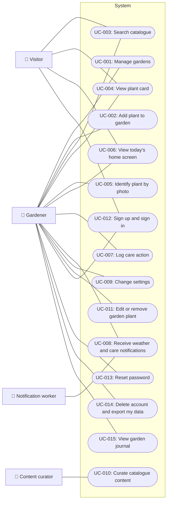

<!-- GENERATED from design/ — do not edit. Rebuild with tools/design/build.py -->
# Actors and use cases

_Generated document · design v1.0.1 · source 684d51011856_

## Actors

| id | name | kind | authenticated | count | description |
|---|---|---|---|---|---|
| ACT-Visitor | Visitor | human | False |  | Anyone using the app without an account; browses the catalogue only (SCOPE-002) |
| ACT-Gardener | Gardener | human | True | tens of thousands (future) | Amateur gardener in Greece, from balcony pots to vegetable plots and village trees |
| ACT-Curator | Content curator | human | True | 1-3 | Imports, cross-checks and publishes plant catalogue content in the Laravel admin panel (agronomist or the owner) |
| ACT-Worker | Notification worker | system | False |  | Runs every few hours: fetches one forecast per weather cell, applies weather x plant rules, sends push |

## Use case diagram

## Use cases

#### UC-001 — Manage gardens (must)

Actors: ACT-Gardener · Goal: Create gardens, each with its own approximate location

Main flow:
1. Gardener creates a garden and gives it a name
2. Sets the location by searching an area, picking a point on the map, or 'current position'
3. The app rounds the coordinates to 2 decimals before sending them
4. The server assigns the climate zone and weather cell
5. Gardener can rename the garden, change its location or delete it

Exceptions:
- Location permission denied when choosing 'current position': the app offers area search or map instead
- No location set: the garden is saved; weather notifications are off for it (SCOPE-004)
- Deleting a garden that has plants: the app asks for confirmation; plants and their care log are deleted with it

Acceptance criteria:
- Given a signed-in gardener, When they create garden 'Μπαλκόνι' at 37.98412, 23.72803, Then the stored location is exactly 37.98, 23.73
- Given a signed-in gardener, When they create a garden without a location, Then the garden is saved and has no climate zone and no weather cell
- Given a gardener who chose area search, Then the app never requests the device location permission
- Given a garden with 3 plants, When the gardener confirms deletion, Then the garden, its 3 plants and their care log entries no longer exist
- Given two gardens at 37.98, 23.73 and 37.99, 23.74, Then both are assigned the same weather cell

> Engineer: “Η τοποθεσία δηλώνεται μία φορά: αναζήτηση περιοχής, σημείο στον χάρτη ή «τρέχουσα θέση» (άδεια GPS μόνο τότε).”

#### UC-002 — Add plant to garden (must)

Actors: ACT-Gardener · Goal: Add plants, trees or seeds with quantity, planting date and position in a few taps

Main flow:
1. Gardener finds a plant (search, plant card or photo identification) and taps 'Add'
2. Chooses the garden (preselected when they have only one)
3. Enters kind (plant, seed or tree), quantity, planting date, pot or ground, pot size, sun exposure
4. Saves; the plant appears in the garden with its next action

Exceptions:
- Visitor without an account taps 'Add': the app asks them to sign in or sign up and then continues the flow
- Gardener has no garden: the app creates one inline before adding

Acceptance criteria:
- Given a gardener with exactly 1 garden, When they tap 'Add' on a plant card, Then the garden is preselected and saving needs no other required field than quantity
- Given the add form, Then the planting date defaults to today and quantity defaults to 1
- Given the add form, When kind is 'ground', Then pot size is not asked
- Given a plant added with quantity 0, Then saving is rejected with a validation message

> Engineer: “Η ροή «Προσθήκη φυτού» (αναζήτηση → επιλογή κήπου → ποσότητα/ημερομηνία/θέση) είναι η πιο συχνή ενέργεια και πρέπει να γίνεται σε λίγα πατήματα.”

#### UC-003 — Search catalogue (must)

Actors: ACT-Visitor, ACT-Gardener · Goal: Find plants by name, synonym or Greeklish, in any language, offline; filter by category and "in season now"

Main flow:
1. User types in the search box
2. Results update from the local catalogue on the device
3. User filters by category or 'in season now' and opens a plant card

Exceptions:
- No results: the app suggests photo identification
- No network: search works the same from the local catalogue

Acceptance criteria:
- Given the catalogue contains 'Ντομάτα', When the user searches 'τοματα', Then 'Ντομάτα' is in the results
- Given the catalogue contains 'Ντομάτα', When the user searches 'ntomata' or 'domata', Then 'Ντομάτα' is in the results
- Given the alias 'ηδύοσμος' for 'Δυόσμος', When the user searches 'ηδυοσμος', Then 'Δυόσμος' is in the results
- Given the UI language is Greek, When the user searches 'basil', Then 'Βασιλικός' is in the results
- Given the device is offline, When the user searches 'σκόρδο', Then results appear without any network request
- Given a visitor without an account, Then search and filters work
- Given a garden in a climate zone where garlic sowing months include the current month, When the user filters 'in season now', Then garlic is listed

#### UC-004 — View plant card (must)

Actors: ACT-Visitor, ACT-Gardener · Goal: Read structured growing conditions, calendar per climate zone, planting, care, seed saving, tips and companions

Main flow:
1. User opens a plant from search, home or their garden
2. Sees identity, growing conditions, calendar, planting, description, care, seed saving, tips and companions in the UI language
3. Can tap 'Add to garden' (UC-002)

Exceptions:
- Text missing in the UI language: the other language is shown, marked as such
- No garden with a climate zone: the calendar shows all zones

Acceptance criteria:
- Given a visitor without an account and no network, When they open a plant card, Then all text sections are shown from the local catalogue
- Given a signed-in gardener whose garden is in a climate zone, When they open a plant card from that garden, Then the calendar shows that zone first
- Given a plant with only Greek text and the UI in English, Then the Greek text is shown with a 'not translated' label
- Given only published plants are on the device, Then an unpublished plant never appears in search or cards

#### UC-005 — Identify plant by photo (must)

Actors: ACT-Gardener · Goal: Get 2-3 likely species with confidence, confirm one, and open or add it

Main flow:
1. Gardener takes or picks a photo
2. The app resizes it to about 1024 px and uploads it to our server
3. The server calls the identification provider, limited to local flora by the garden location
4. The app shows 2-3 candidates with confidence; when started from a garden, the gardener's own plants are listed first
5. Gardener confirms one; the app opens its plant card or the add flow

Exceptions:
- Candidate not in our catalogue: shown with its scientific name and marked 'not in catalogue'; cannot be added
- Provider unavailable or daily quota reached: the app says identification is temporarily unavailable
- Gardener's own limit reached: the app says when it resets
- No candidate above the minimum confidence: the app says it could not identify the plant

Acceptance criteria:
- Given a 4000x3000 photo, When it is uploaded, Then the uploaded image's longest side is at most 1024 px
- Given a provider result with 5 candidates, Then at most 3 are shown, each with a confidence percentage
- Given identification started from a garden containing tomato, When tomato is among the candidates, Then tomato is shown first
- Given a candidate with GBIF id matching a catalogue plant, Then it links to that plant card
- Given the provider is down, Then the app shows 'temporarily unavailable' and no error code
- Given the identification results screen, Then the Pl@ntNet attribution is visible
- Given the mobile app build, Then it contains no identification provider API key
- Given a gardener who made 10 identifications today, When they request an 11th, Then it is refused with the time the limit resets
- Given a visitor without an account, When they tap photo identification, Then the app asks them to sign in
- Given a gardener with 9 identifications today, When the 10th fails because the provider is down, Then they can still make 1 more identification today

> Engineer: “Στο MVP: Pl@ntNet API (δωρεάν έως 500 αναγνωρίσεις/ημέρα, με υποχρεωτική αναφορά).”

#### UC-006 — View today's home screen (must)

Actors: ACT-Visitor, ACT-Gardener · Goal: See garden weather, today's notifications, garden summary, seasonal ideas and a tip

Main flow:
1. Gardener opens the app
2. Sees, per garden with a location, today's weather and today's notifications
3. Sees a summary of gardens with the next actions
4. Sees seasonal ideas for the garden's climate zone and a tip

Exceptions:
- No network: the last loaded home data is shown with its time
- No garden: the screen invites the gardener to create one

Acceptance criteria:
- Given 2 gardens with locations, Then the home screen shows the weather of each garden, not of the device position
- Given a garden without a location, Then it appears in the summary without weather
- Given the device is offline, Then the last loaded data is shown with the time it was loaded
- Given a visitor without an account, Then the home screen shows seasonal ideas and a tip for Greece in general and an invitation to sign up, and no weather

#### UC-007 — Log care action (must)

Actors: ACT-Gardener · Goal: Record watering, fertilising and other actions; derive the next action per plant

Main flow:
1. Gardener opens a plant in their garden and taps an action (watering, fertilising, pruning, weeding, spraying, harvest, other)
2. Optionally changes the date (default today), adds a note or a photo
3. Saves; the plant's next action is recalculated

Exceptions:
- Date in the future: rejected

Acceptance criteria:
- Given a tomato with a fertilising interval of 14 days in the catalogue, When fertilising is logged on 2026-05-01, Then the next fertilising is due on 2026-05-15
- Given an action logged with date 2026-05-02 on 2026-05-05, Then it is stored with done_on 2026-05-02
- Given a date after today, Then saving is rejected

> Engineer: “Το care_log είναι ταυτόχρονα το ημερολόγιο κήπου: από αυτό βγαίνουν «επόμενη ενέργεια» και, με τα χρόνια, σύγκριση με προηγούμενες σεζόν.”

#### UC-008 — Receive weather and care notifications (must)

Actors: ACT-Worker, ACT-Gardener · Goal: Morning push per garden from rain, heatwave, frost, care and season rules

Main flow:
1. The worker runs every few hours and fetches one forecast per weather cell that has at least one garden
2. Applies the rules (rain, heatwave, frost, care due, season) to each garden's plants
3. Builds at most one summary per garden per day in the user's language and sends it at 07:30 Europe/Athens
4. Frost and heatwave alerts are sent as soon as the worker detects them, except during quiet hours 22:00-07:00, when they wait until 07:00
5. Gardener opens the notification and lands on the garden

Exceptions:
- Weather provider unavailable: the last cached forecast is used if it is less than 12 hours old, otherwise weather rules are skipped for that run
- Push token invalid: the token is removed; the notification stays visible in the app
- Nothing to say for a garden: no summary is sent

Acceptance criteria:
- Given a forecast of 12 mm rain in the next 24 h for a garden, Then the summary contains the 'do not water' message for that garden
- Given a forecast of 9 mm rain in the next 24 h, Then no rain message is generated
- Given a forecast maximum of 38 °C, Then a heatwave message is generated; given 37 °C, Then it is not
- Given a forecast minimum of 2 °C and a frost-sensitive plant in the garden, Then a frost alert is generated; given 3 °C, Then it is not
- Given 2 gardens in the same weather cell, When the worker runs, Then the weather provider is called once for that cell
- Given a garden that already received a summary today, When the worker runs again, Then no second summary is sent
- Given a user whose language is English, Then the notification text is in English
- Given a garden without a location, Then no weather message is generated for it
- Given the thresholds 10 mm, 38 °C and 2 °C, Then they are read from configuration, not hard-coded
- Given a frost alert detected at 15:00, Then it is sent at 15:00 without waiting for the next summary
- Given a frost alert detected at 23:00, Then it is sent at 07:00 the next morning
- Given the summary for a garden, Then it is sent at 07:30 Europe/Athens
- Given a garden with no messages for today, Then no summary is sent
- Given the push service is down from 07:30 to 10:30, Then that day's summary is not pushed and is visible in the app

> Engineer: “Οι ειδοποιήσεις παράγονται στον server από κανόνες «καιρός × φυτό», όχι από σταθερό χρονόμετρο.”

#### UC-009 — Change settings (must)

Actors: ACT-Gardener · Goal: Language (Greek/English), gardens and location, notification preferences

Main flow:
1. Gardener changes the language; the UI switches and the server stores it for notifications
2. Turns notification types on or off
3. Manages gardens and their locations (UC-001)

Acceptance criteria:
- Given a first launch on a device set to Greek, Then the UI is in Greek; on any other device language, Then English
- Given the gardener switches to English, Then the stored user language on the server is 'en'
- Given the gardener turned off care reminders, Then no care messages are included in their summaries

#### UC-010 — Curate catalogue content (must)

Actors: ACT-Curator · Goal: Import facts from open sources, cross-check, review and publish plants

Main flow:
1. Curator signs in to the Laravel admin panel
2. Creates or imports a plant with its structured fields, translations, aliases, calendar per climate zone and companions
3. Records the source and licence of imported facts
4. Marks the plant reviewed and publishes it
5. Published changes reach the devices with the next catalogue sync

Exceptions:
- Required structured field missing: the plant cannot be published

Acceptance criteria:
- Given a gardener account, When it opens the admin panel, Then access is denied
- Given a plant without a scientific name, Then it cannot be published
- Given a draft plant, Then it is not included in the catalogue sent to devices
- Given a plant is published, When a device syncs, Then the plant becomes searchable offline

#### UC-011 — Edit or remove garden plant (must)

Actors: ACT-Gardener · Goal: Change quantity, position or notes of a plant in a garden, or remove it

Main flow:
1. Gardener opens a plant in their garden
2. Edits quantity, planting date, pot or ground, pot size, sun exposure or notes, or removes it

Acceptance criteria:
- Given a garden plant with 2 care log entries, When the gardener removes it, Then it no longer appears in the garden, no notifications are generated for it, and its 2 care log entries remain in the garden journal

#### UC-012 — Sign up and sign in (must)

Actors: ACT-Visitor, ACT-Gardener · Goal: Create an account with email and password, and sign in on a device

Main flow:
1. Visitor enters email and password
2. Confirms the email through a link
3. Signs in; the device registers for push

Exceptions:
- Email already registered: the app offers sign-in or password reset
- Wrong password: generic error that does not reveal whether the email exists

Acceptance criteria:
- Given an email that is already registered, When a visitor signs up with it, Then no second account is created
- Given a wrong password, Then the error message is the same as for an unknown email

#### UC-013 — Reset password (must)

Actors: ACT-Gardener · Goal: Regain access to the account by email

Main flow:
1. Gardener requests a reset with their email
2. Receives a one-time link and sets a new password

Acceptance criteria:
- Given a reset link already used once, When it is opened again, Then it is rejected
- Given an unknown email, When a reset is requested, Then the response is the same as for a known email

#### UC-014 — Delete account and export my data (must)

Actors: ACT-Gardener · Goal: GDPR rights to erasure and portability for gardens, plants, care log and photos

Main flow:
1. Gardener requests an export and receives a file with all their data
2. Gardener deletes the account after confirming

Acceptance criteria:
- Given a gardener with 2 gardens, 5 plants and 10 care log entries, When they export, Then the file contains all 2 gardens, 5 plants and 10 entries
- Given a gardener deletes their account, Then their gardens, plants, care log, photos, notifications and push tokens no longer exist

#### UC-015 — View garden journal (should)

Actors: ACT-Gardener · Goal: See the care log of a garden or plant over time
